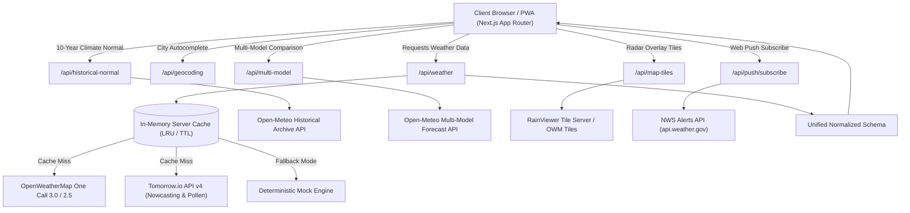

<div align="center">

# 🌤️ Weatherly

**Advanced Hyperlocal Weather Forecasting, Live Radar & Climate Intelligence**

A high-precision, production-ready weather application built with **Next.js (App Router)**, **React 19**, **TypeScript**, and **Tailwind CSS**. Powered by a multi-source meteorological pipeline including **OpenWeatherMap**, **Tomorrow.io**, **Open-Meteo**, **RainViewer**, and the **National Weather Service (NWS)**.

[](https://weatherlyforecastly.vercel.app/)
[](https://nextjs.org/)
[](https://react.dev/)
[](https://www.typescriptlang.org/)
[](https://tailwindcss.com/)
[](LICENSE)

### 🔗 **Live Application:** [https://weatherlyforecastly.vercel.app/](https://weatherlyforecastly.vercel.app/)

</div>

---

## 📖 Table of Contents

- [Overview](#-overview)
- [Key Features](#-key-features)
  - [1. Core Forecasting & Atmospheric Metrics](#1-core-forecasting--atmospheric-metrics)
  - [2. Interactive RainViewer Radar & Scrubbing Loops](#2-interactive-rainviewer-radar--scrubbing-loops)
  - [3. Multi-Model Forecast Comparison & Ensemble Spread](#3-multi-model-forecast-comparison--ensemble-spread)
  - [4. 10-Year Historical Climate Analysis](#4-10-year-historical-climate-analysis)
  - [5. Severe Alerts & Web Push Notifications](#5-severe-alerts--web-push-notifications)
  - [6. Air Quality (AQI) & Airborne Allergen Tracking](#6-air-quality-aqi--airborne-allergen-tracking)
  - [7. Astronomy & Smart Activity Advisor](#7-astronomy--smart-activity-advisor)
  - [8. Drag-and-Drop Dashboard & PWA Offline Support](#8-drag-and-drop-dashboard--pwa-offline-support)
- [Architecture & Data Pipeline](#-architecture--data-pipeline)
- [Project Directory Structure](#-project-directory-structure)
- [Tech Stack](#-tech-stack)
- [Getting Started](#-getting-started)
  - [Prerequisites](#prerequisites)
  - [Installation](#installation)
  - [Environment Variables](#environment-variables)
  - [Development Server](#development-server)
  - [Production Build](#production-build)
- [Deployment on Vercel](#-deployment-on-vercel)
- [Security & Performance](#-security--performance)
- [License](#-license)

---

## 🌟 Overview

**Weatherly** bridges the gap between consumer weather apps and scientific meteorological dashboards. Rather than relying on a single weather provider, Weatherly orchestrates a resilient multi-tier data pipeline:

- **OpenWeatherMap One Call 3.0 & 2.5 Fallback**: Primary current conditions, 48-hour hourly curves, 7-day daily forecasts, and reverse geocoding.
- **Tomorrow.io API v4**: High-frequency, minute-by-minute precipitation nowcasting (next 60 min), airborne pollen indices, and air quality metrics.
- **Open-Meteo Multi-Model Ensemble**: Inter-model comparisons across ECMWF IFS (European), GFS (NOAA/US), and ICON (German Weather Service) with confidence indices.
- **Open-Meteo Climate Archive**: 10-year historical climate baselines for the exact calendar date.
- **RainViewer Live API**: Keyless 2-hour radar timeline scrubbing and playback animations.
- **National Weather Service (NWS)**: Active severe weather alert ingestion and push dispatching.

---

## ✨ Key Features

### 1. Core Forecasting & Atmospheric Metrics
- **Current Hero Card**: Temperature, "Feels Like", daily min/max, humidity, barometric pressure, UV index with risk rating, visibility, and calculated dew point.
- **60-Minute Precipitation Nowcast (Tomorrow.io)**: Minute-by-minute precipitation intensity and probability bar chart with dynamic headline summaries (e.g., *"Rain stopping in ~18 minutes"*).
- **48-Hour Hourly Outlook**: Dual-view toggle between an interactive **Recharts area curve** (with precipitation probability) and a scrollable hourly card ribbon.
- **7-Day Extended Forecast**: Daily temperature range bars relative to weekly extremes, condition summaries, and expandable deep dives (morning, afternoon, evening, and overnight splits).

### 2. Interactive RainViewer Radar & Scrubbing Loops
- **Zero-Key Radar Streaming**: Powered directly by the **RainViewer API** without requiring third-party credentials.
- **Past 2-Hour Timeline Scrubber**: Interactive timeline slider allowing users to scrub backwards through 13 historical radar frames with precise timestamps (`-2h` to `Now`).
- **Play/Pause Radar Animation**: Animated playback loop cycling through radar imagery at 700ms intervals.
- **Multi-Layer Switching**: Toggle between **Radar**, **Cloud Cover**, **Wind Speed**, and **Temperature** heatmap overlays atop an OpenStreetMap dark-mode base map.
- **Fullscreen Radar Modal**: Dedicated full-viewport interactive radar viewing mode.

### 3. Multi-Model Forecast Comparison & Ensemble Spread
- **Triple Global Models**: Side-by-side comparison of **ECMWF IFS (European)**, **GFS (NOAA / US)**, and **ICON (German DWD)** via Open-Meteo.
- **Confidence Rating**: Algorithmic evaluation of inter-model spread (e.g., `High (90%+ agreement)`, `Moderate (75% agreement)`, or `Fair`) displayed directly above the chart.
- **Interactive Multi-Line Chart**: Hover tooltips show simultaneous predictions from all three models with real-time variance calculations.

### 4. 10-Year Historical Climate Analysis
- **Decade Climate Normal**: Server-side query comparing current temperatures against the actual 10-year historical average for today's calendar date.
- **Hero Delta Badge**: Instant visual indicator on the main card (e.g., `+3.4°C warmer than 10-yr usual` / `-1.2°C cooler than usual`).
- **Climate Extremes**: Displays the all-time 10-year record high and low observed on this day.

### 5. Severe Alerts & Web Push Notifications
- **Urgent Meteorological Banners**: Collapsible, color-coded in-app alert cards for Warnings (Rose), Watches (Amber), and Advisories (Yellow).
- **Web Push API**: Native browser push notifications powered by VAPID key pairs and Service Worker event handlers.
- **Background Cron Check**: `/api/push/check-alerts` endpoint compatible with Vercel Cron to periodically inspect active NWS alerts (`api.weather.gov`) and notify subscribers.
- **Instant Test Trigger**: Test push button in the header settings modal for immediate verification.

### 6. Air Quality (AQI) & Airborne Allergen Tracking
- **US EPA AQI Gauge (0–500)**: Color-spectrum indicator with categorized health guidance (Good, Moderate, Unhealthy for Sensitive Groups, Unhealthy, Hazardous).
- **6-Pollutant Breakdown**: Dedicated concentrations for **PM2.5**, **PM10**, **O₃**, **NO₂**, **CO**, and **SO₂**.
- **Allergen Risk**: Comprehensive monitoring for **Tree**, **Grass**, and **Weed** pollen risk levels from Tomorrow.io.

### 7. Astronomy & Smart Activity Advisor
- **Daylight Trajectory Arc**: SVG parabolic daylight arc showing sun elevation, exact sunrise/sunset times, remaining daylight hours, and a `% elapsed` progress bar.
- **Photorealistic Moon Phase**: Real-time lunar cycle calculator with illuminated percentage and phase names (Waxing Crescent, Full Moon, Waning Gibbous, etc.).
- **Smart Activity Recommendations**: Context-aware suitability scores (0–100%) for **Running & Cardio**, **Cycling & Commuting**, **Outdoor Dining**, and **Stargazing**.
- **Gear Advisories**: Automated reminders for umbrellas, high-UV sunscreen protection, and thermal outerwear.

### 8. Drag-and-Drop Dashboard & PWA Offline Support
- **`@dnd-kit` Reordering**: Direct drag-and-drop dashboard widget sorting with pointer, touch, and keyboard sensors, automatically persisted in `localStorage`.
- **Installable PWA**: Configured with `manifest.json` and a Service Worker (`sw.js`) for seamless mobile and desktop installation.
- **Offline Resiliency**: Automatically falls back to the last cached forecast payload in `localStorage` when offline, presenting a non-intrusive alert banner.
- **Unit Conversions**: Instant client-side switching between **°C / °F**, **km/h / mph / m/s**, **mm / inches**, and **hPa / inHg** without redundant network queries.
- **Dynamic Sky FX**: Ambient CSS gradients and procedural raindrops that dynamically reflect real-time atmospheric conditions and day/night cycles.

---

## 🏗️ Architecture & Data Pipeline



---

## 📁 Project Directory Structure

```
Weatherly/
├── public/
│   ├── manifest.json              # PWA Web App Manifest
│   ├── sw.js                      # Service Worker (offline cache + Web Push listener)
│   ├── favicon.ico
│   └── *.svg                      # Application assets
├── src/
│   ├── app/
│   │   ├── api/
│   │   │   ├── geocoding/         # City search autocomplete & reverse coordinates
│   │   │   ├── historical/        # Climate baseline comparisons
│   │   │   ├── historical-normal/ # Open-Meteo 10-year historical climate archive
│   │   │   ├── map-tiles/         # Secure radar/weather map tile proxy
│   │   │   ├── multi-model/       # ECMWF, GFS, ICON multi-model comparison
│   │   │   ├── push/              # Web Push subscription, dispatch & NWS cron checks
│   │   │   └── weather/           # Centralized aggregator proxy (OWM + Tomorrow.io)
│   │   ├── globals.css            # Glassmorphism, Leaflet styles & rain animations
│   │   ├── layout.tsx             # Root layout, fonts, PWA registration & metadata
│   │   └── page.tsx               # Main Dashboard page
│   ├── components/
│   │   ├── activities/            # Outdoor activity advisor & gear warnings
│   │   ├── airquality/            # AQI (US EPA) & Pollen tracker widgets
│   │   ├── alerts/                # Severe weather banners & expandable advisories
│   │   ├── astronomy/             # Sun trajectory arc & moon phase visualizer
│   │   ├── background/            # Procedural dynamic sky gradients & rain FX
│   │   ├── dashboard/             # @dnd-kit WidgetContainer, Customizer & Grid
│   │   ├── forecast/              # Hero card, Hourly curve, Daily list, Minutely nowcast
│   │   ├── map/                   # RainViewer radar, Leaflet map & fullscreen modal
│   │   ├── navigation/            # Header, search autocomplete, unit toggles & settings
│   │   ├── providers/             # Unified context providers wrapper
│   │   └── pwa/                   # PWA Service Worker lifecycle registration
│   └── lib/
│       ├── api/
│       │   ├── cache.ts           # Server-side in-memory cache with TTL eviction
│       │   ├── mock-weather.ts    # Realistic simulated fallback engine
│       │   ├── openweather.ts     # OpenWeatherMap client (3.0 + 2.5 fallback)
│       │   ├── push-subscriptions.ts # Web Push VAPID configuration & subscriber store
│       │   ├── tomorrow.ts        # Tomorrow.io client (1m nowcast & pollen)
│       │   └── weather-service.ts # Unified meteorological orchestrator
│       ├── context/               # Weather, Units, Theme & WidgetOrder contexts
│       ├── types/                 # TypeScript interfaces and models
│       └── utils/                 # Unit conversions, compass calculations & icon mapping
├── .env.example                   # Environment configuration template
├── LICENSE                        # MIT License
├── package.json
└── README.md
```

---

## 💻 Tech Stack

| Category | Technology | Purpose |
| :--- | :--- | :--- |
| **Framework** | [Next.js 16 (App Router)](https://nextjs.org/) | React Server Components, Route Handlers, Turbopack |
| **UI Library** | [React 19](https://react.dev/) | Component architecture & client state |
| **Language** | [TypeScript 5](https://www.typescriptlang.org/) | End-to-end type safety |
| **Styling** | [Tailwind CSS v4](https://tailwindcss.com/) | Modern glassmorphism, responsive utilities, custom tokens |
| **Charting** | [Recharts](https://recharts.org/) | 48-hour outlook area curves & multi-model comparison lines |
| **Mapping** | [Leaflet](https://leafletjs.com/) | Interactive maps with RainViewer and OpenStreetMap tiles |
| **Drag & Drop** | [@dnd-kit](https://dndkit.com/) | Accessible, fluid dashboard card reordering |
| **Push Notifications** | [web-push](https://github.com/web-push-libs/web-push) | Standards-compliant VAPID Web Push delivery |
| **Icons** | [Lucide React](https://lucide.dev/) | Clean, modern iconography |
| **Deployment** | [Vercel](https://vercel.com/) | Global edge delivery, serverless execution & CI/CD |

---

## 🚀 Getting Started

### Prerequisites
- **Node.js**: `v18.18+` or `v20+` / `v24+`
- **Package Manager**: `npm`, `pnpm`, or `yarn`

### Installation

1. **Clone the repository:**
   ```bash
   git clone https://github.com/nishanthkumarbs/Weatherly.git
   cd Weatherly
   ```

2. **Install project dependencies:**
   ```bash
   npm install
   ```

### Environment Variables

Copy the `.env.example` file to create your local `.env.local`:

```bash
cp .env.example .env.local
```

Configure your API keys in `.env.local`:

```ini
# OpenWeatherMap API Key (One Call 3.0 or standard 2.5)
# Get a key at: https://openweathermap.org/api
OPENWEATHER_API_KEY=your_openweather_api_key

# Tomorrow.io API Key (1-min nowcasting, pollen, AQI)
# Get a key at: https://www.tomorrow.io/weather-api/
TOMORROW_API_KEY=your_tomorrow_api_key

# Optional Defaults
NEXT_PUBLIC_DEFAULT_CITY=New York
NEXT_PUBLIC_DEFAULT_LAT=40.7128
NEXT_PUBLIC_DEFAULT_LON=-74.0060

# Optional: Web Push VAPID keys (pre-configured with working defaults)
# NEXT_PUBLIC_VAPID_PUBLIC_KEY=...
# VAPID_PRIVATE_KEY=...
```

> 💡 **Out-of-the-Box Demo Mode:**
> If you run Weatherly without entering API keys, the built-in deterministic simulation engine automatically serves realistic, location-aware weather telemetry for any city or coordinate, enabling immediate exploration of all dashboard features!

### Development Server

Run the development server with Hot Module Replacement:

```bash
npm run dev
```

Open [http://localhost:3000](http://localhost:3000) in your browser.

### Production Build

Create an optimized production bundle:

```bash
npm run build
npm run start
```

---

## ☁️ Deployment on Vercel

The application is optimized for seamless zero-configuration deployment on **Vercel**:

1. Push your repository to GitHub.
2. Go to **[vercel.com/new](https://vercel.com/new)** and import `nishanthkumarbs/Weatherly`.
3. Under **Environment Variables**, add:
   - `OPENWEATHER_API_KEY`
   - `TOMORROW_API_KEY`
4. Click **Deploy**. Vercel will automatically compile the project with Turbopack and deploy the serverless API routes.

Live production deployment: **[https://weatherlyforecastly.vercel.app/](https://weatherlyforecastly.vercel.app/)**

---

## 🔒 Security & Performance

- **Zero Key Leakage**: API keys (`OPENWEATHER_API_KEY`, `TOMORROW_API_KEY`, and `VAPID_PRIVATE_KEY`) are kept strictly server-side within Next.js API routes (`/api/*`). No third-party API keys are ever bundled into client-side JavaScript.
- **In-Memory TTL Caching**: Server-side cache dramatically reduces outbound upstream calls and prevents rate-limit lockouts:
  - Forecasts & Current weather: **5 minutes**
  - Minutely nowcasting: **2 minutes**
  - Multi-model ensemble: **30 minutes**
  - Geocoding autocomplete: **1 hour**
  - Historical climate normals: **24 hours**
- **Client-Safe Map Rendering**: Leaflet map components are loaded dynamically (`ssr: false`) to avoid server-side hydration mismatches.
- **PWA Caching Strategy**: Network-first strategy with cache fallback for instant loads and graceful offline functionality.

---

## 📄 License

This project is open-source and available under the [MIT License](LICENSE).

Copyright (c) 2026 **Nishanth Kumar B S**.
